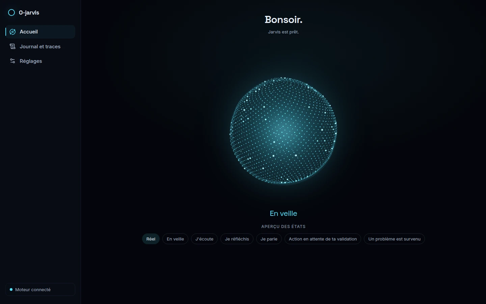
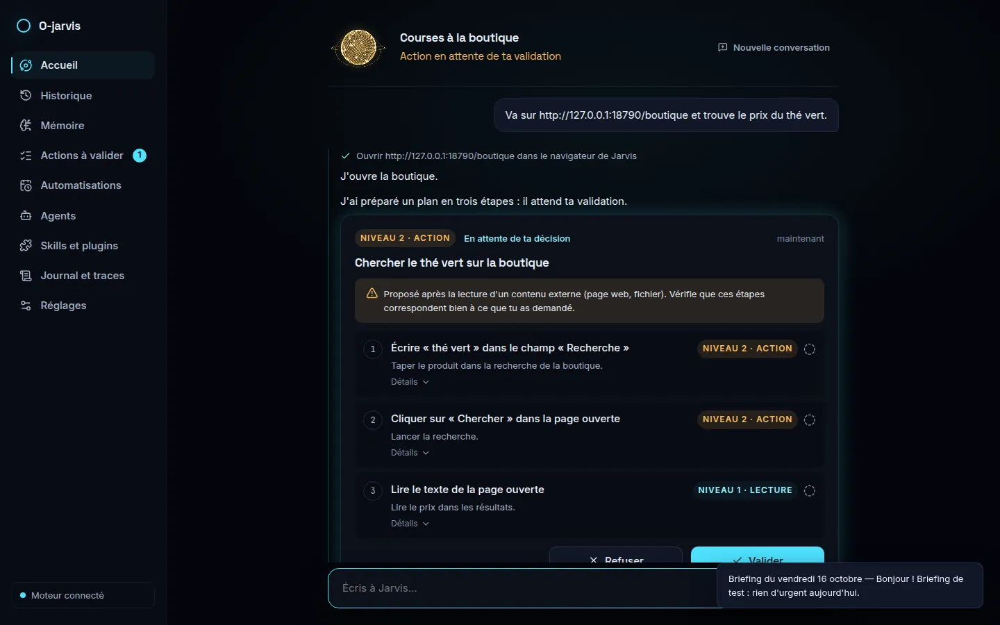
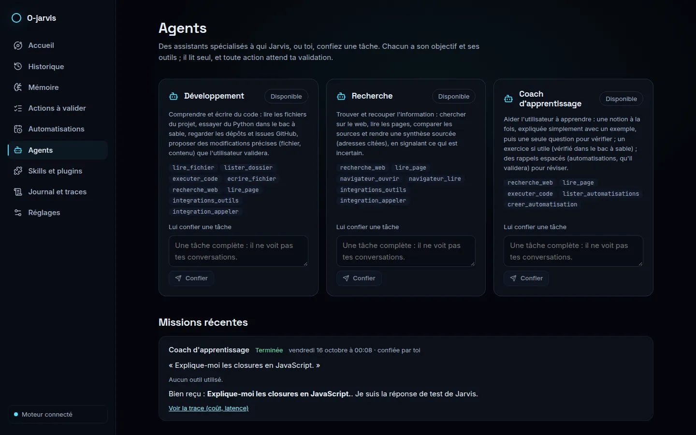
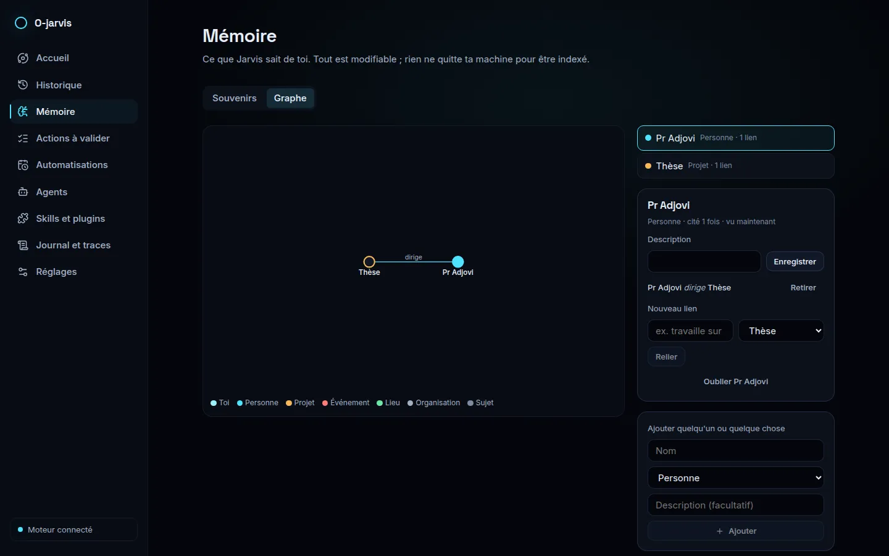

# O-jarvis

Assistant personnel desktop pour Ubuntu. On lui parle à voix haute (« Hey Jarvis »), il se souvient, agit sous contrôle et sait s'étendre.



- **App** : Tauri v2 (Rust) + React + TypeScript.
- **Cerveau** : moteur Python (FastAPI) lancé par l'app, sur `127.0.0.1` uniquement, protégé par un jeton tiré à chaque lancement.
- **Voix** : « Hey Jarvis » reconnu en local, transcription Groq (français imposé, Whisper local en secours), voix Cartesia ou Piper ; réponse parlée en moins de 2 s ; on peut l'interrompre en parlant. Raccourci global : `Ctrl+Alt+J`.
- **Mémoire** : ce que Jarvis sait de toi est visible, modifiable et supprimable.
- **Actions** : il cherche sur le web, lit pages et fichiers, lance du code en bac à sable et pilote son propre navigateur. Toute action (cliquer, écrire, utiliser ta session) passe par un plan que tu valides ; chaque action est écrite dans un journal impossible à effacer. Détails : [`docs/securite.md`](./docs/securite.md).
- **Organisation** : rappels et tâches à l'heure dite ou sur un événement, qui survivent à un redémarrage ; briefing du matin ; GitHub, Notion et Google Agenda par leurs serveurs MCP officiels ; Telegram pour lui parler depuis ton téléphone.
- **Contrôle du PC** (désactivé par défaut, à activer dans Réglages) : ouvrir et fermer tes applications, ranger tes fichiers, « regarde mon écran » (lu sur ta machine par défaut, ou en ligne si tu le choisis).
- **Extension** : Jarvis s'écrit des skills (code testé dans le bac à sable, activé après ta double confirmation), installe des serveurs MCP du registre officiel (isolés), confie des tâches à ses agents (dev, recherche, coach), relie ta vie dans une mémoire graphe et te suggère d'automatiser ce que tu demandes souvent. Voir [`docs/creer-un-skill.md`](./docs/creer-un-skill.md).
- **Données** : SQLite local ; les clés vivent dans le trousseau du système.

| Conversation et plan à valider | Agents | Mémoire graphe |
|---|---|---|
|  |  |  |

Le projet s'est construit phase par phase. L'état du travail est dans [`PROGRESS.md`](./PROGRESS.md), les choix dans [`DECISIONS.md`](./DECISIONS.md), le journal dans [`docs/journal/`](./docs/journal/README.md), le schéma dans [`docs/architecture.md`](./docs/architecture.md).

## Ce que Jarvis sait faire

Une suite de 44 scénarios, joués avec le vrai modèle, le vérifie du plus simple au plus difficile : comprendre une question pleine de fautes, écrire un fichier seulement après ta validation, ignorer une page piégée, réparer un petit projet Python. Dernière série : **43 réussis sur 43 joués** (le 44ᵉ agit sur ton bureau et ne se joue qu'à la demande), sans aucune action exécutée sans validation. Le tableau complet est dans [`docs/scenarios.md`](./docs/scenarios.md).

## Installer

Ubuntu 24.04 ou plus récent (glibc 2.39 ; vérifié sur Ubuntu 26.04). Récupère les paquets de la [dernière version](https://github.com/octavebahoun/O-jarvis/releases/latest) ou construis-les (`scripts/build-release.sh`, ~15 min ; ils arrivent dans `app/src-tauri/target/release/bundle/`), puis :

```bash
sudo apt install ./O-jarvis_1.0.0_amd64.deb      # paquet Debian/Ubuntu
# ou, sans installation :
chmod +x O-jarvis_1.0.0_amd64.AppImage && ./O-jarvis_1.0.0_amd64.AppImage
```

Au premier lancement : renseigne tes clés dans Réglages (ou dépose un `.env` dans `~/.config/o-jarvis/` : l'app importe ses clés dans le trousseau), puis attends la voix (modèles téléchargés une fois, ~350 Mo). Réglages → Démarrage : lancer O-jarvis à l'ouverture de session.

## Installer pour le développement

Ubuntu 24.04 ou plus récent, Node.js 22+. Le script n'utilise pas sudo : s'il manque des paquets système, il affiche la commande `apt` à lancer.

```bash
git clone https://github.com/octavebahoun/O-jarvis.git
cd O-jarvis
scripts/install-dev.sh
```

Complète ensuite `.env` avec tes clés (voir `.env.example`). Au premier lancement, l'app les importe dans le trousseau.

## Lancer

```bash
cd app && pnpm tauri dev          # développement, rechargement à chaud
scripts/install-launcher.sh       # compile et ajoute « O-jarvis » au menu des applications
```

Fermer la fenêtre arrête tout, moteur compris. `Ctrl+Q` aussi.

Au premier lancement, le moteur télécharge ses modèles locaux (environ 350 Mo : recherche par le sens, mot de réveil, transcription, voix de secours), puis la voix est prête. Le script d'installation installe aussi le Chromium du navigateur de Jarvis (environ 170 Mo) et l'image Docker du bac à sable. Au premier lancement par l'icône, GNOME demande d'autoriser le raccourci `Ctrl+Alt+J`.

## Vérifier

```bash
cd engine && uv run pytest -m "not real"     # moteur
cd app && pnpm test && pnpm e2e               # interface, puis bout en bout avec le vrai moteur
cd app/src-tauri && cargo test                # coque
cd engine && uv run python tools/voice_bench.py --only cartesia   # voix : réveil et latence réels
```
