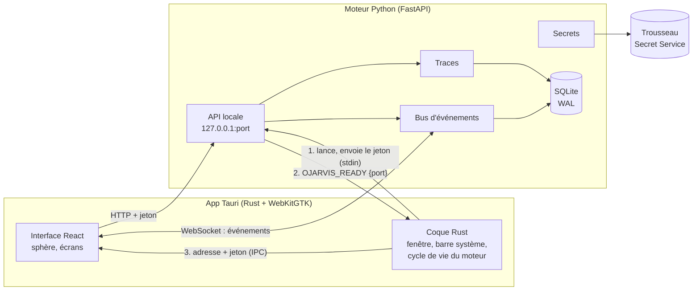

# Architecture

O-jarvis tient en deux processus sur ta machine : l'**app** (ce que tu vois) et le **moteur** (ce qui réfléchit). Pas de serveur distant, pas de Docker pour le cœur.

## Le démarrage, pas à pas

1. Tu cliques sur l'icône. La coque Rust démarre et lance le moteur Python comme processus enfant.
2. Elle tire un **jeton aléatoire** (32 octets) et l'écrit sur l'entrée standard du moteur. Le jeton n'apparaît ni dans la ligne de commande ni dans les variables d'environnement.
3. Le moteur choisit un port libre sur `127.0.0.1`, applique les migrations de la base, puis répond `OJARVIS_READY {"port": ...}` sur sa sortie standard.
4. L'interface demande à la coque l'adresse et le jeton, puis parle au moteur en HTTP et reçoit ses événements par WebSocket.

## L'arrêt

Fermer la fenêtre (ou `Ctrl+Q`, ou « Quitter » dans la barre système) ferme l'entrée standard du moteur. Le moteur voit la fin de flux et s'arrête proprement. Si la coque plante, le système ferme ce même flux : le moteur s'arrête aussi. Après 7 s sans arrêt, la coque le tue.

## Qui protège quoi

| Menace | Protection |
|---|---|
| Un autre programme appelle le moteur | Jeton obligatoire sur chaque requête ; écoute sur `127.0.0.1` uniquement |
| Une page web malveillante vise `127.0.0.1` | Vérification de l'hôte (anti « DNS rebinding ») et de l'origine (CORS, WebSocket) |
| Une clé fuit dans les logs | Filtre qui masque toute valeur du trousseau, le jeton de session et les formats de clés connus |
| Une clé fuit vers l'interface | L'API n'a aucune route qui renvoie une valeur de secret |
| Deux moteurs écrivent la même base | Verrou exclusif par dossier de données |

## Où sont les données

| Quoi | Où |
|---|---|
| Base SQLite | `~/.local/share/o-jarvis/ojarvis.db` |
| Logs du moteur | `~/.local/state/o-jarvis/logs/engine.log` |
| Mesures de fluidité | `~/.local/state/o-jarvis/perf/` |
| Clés | trousseau GNOME, service `o-jarvis` |

## Les dossiers du dépôt

| Dossier | Contenu |
|---|---|
| `app/src` | Interface React : écrans, sphère, client du moteur |
| `app/src-tauri` | Coque Rust : fenêtre, barre système, lancement du moteur |
| `engine/src/ojarvis` | Moteur : API, secrets, bus, traces, base |
| `docs/journal` | Une page par évolution |
| `scripts` | Installation de développement, lanceur |
