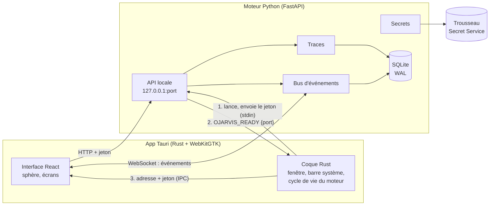
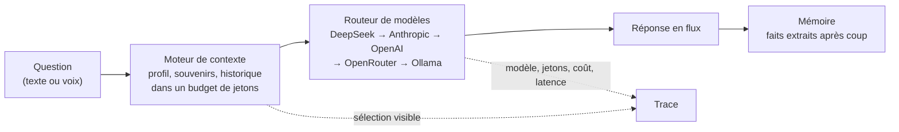
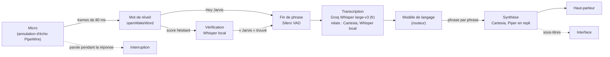
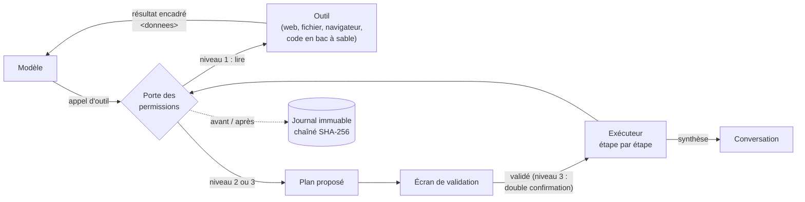

# Architecture

O-jarvis tient en deux processus sur ta machine : l'**app** (ce que tu vois) et le **moteur** (ce qui réfléchit). Pas de serveur distant, pas de Docker pour le cœur.

## Le démarrage, pas à pas

1. Tu cliques sur l'icône. La coque Rust démarre et lance le moteur Python comme processus enfant.
2. Elle tire un **jeton aléatoire** (32 octets) et l'écrit sur l'entrée standard du moteur. Le jeton n'apparaît ni dans la ligne de commande ni dans les variables d'environnement.
3. Le moteur choisit un port libre sur `127.0.0.1`, applique les migrations de la base, puis répond `OJARVIS_READY {"port": ...}` sur sa sortie standard.
4. L'interface demande à la coque l'adresse et le jeton, puis parle au moteur en HTTP et reçoit ses événements par WebSocket.

## L'arrêt

Fermer la fenêtre (ou `Ctrl+Q`, ou « Quitter » dans la barre système) ferme l'entrée standard du moteur. Le moteur voit la fin de flux et s'arrête proprement. Si la coque plante, le système ferme ce même flux : le moteur s'arrête aussi. Après 7 s sans arrêt, la coque le tue.

## Une question, du texte à la réponse

Le routeur prend le premier fournisseur disponible pour la tâche (voix, chat, réflexion…). S'il ne répond pas assez vite (5 s pour la voix), il passe au suivant et l'interface le signale.

## La voix

Le réveil et la détection de parole tournent sur la machine : aucun son ne la quitte avant « Hey Jarvis ». Ensuite, seule la phrase qui suit part chez Groq pour être transcrite (réglage « locale » : rien ne sort, Whisper tourne ici). Le micro reste écouté pendant que Jarvis parle, ce qui permet de l'interrompre.

## Jarvis agit

- **Une seule porte** (`permissions/gate.py`) exécute les outils. Niveau 1 : tout de suite. Niveau 2 : seulement avec la validation d'une étape d'un plan. Niveau 3 : avec la double confirmation. Une étape ne peut pas dépasser le niveau que tu as vu.
- **Le modèle n'agit jamais seul.** S'il appelle directement une action, elle devient un plan d'une étape. S'il a lu un contenu externe juste avant, le plan est signalé, et ouvrir une adresse qu'il a fabriquée demande aussi ta validation.
- **Le navigateur de Jarvis** (`browser/`) : Chromium piloté par Playwright, avec deux contextes. L'anonyme lit sans aucun cookie. L'« identité » ne contient que les sessions des domaines autorisés (coffre chiffré) : y aller est une action de niveau 2. Tout le trafic passe par un proxy local qui n'atteint que des adresses publiques.

## Qui protège quoi

| Menace | Protection |
|---|---|
| Un autre programme appelle le moteur | Jeton obligatoire sur chaque requête ; écoute sur `127.0.0.1` uniquement |
| Une page web malveillante vise `127.0.0.1` | Vérification de l'hôte (anti « DNS rebinding ») et de l'origine (CORS, WebSocket) |
| Une clé fuit dans les logs | Filtre qui masque toute valeur du trousseau, le jeton de session et les formats de clés connus |
| Une clé fuit vers l'interface | L'API n'a aucune route qui renvoie une valeur de secret |
| Deux moteurs écrivent la même base | Verrou exclusif par dossier de données |
| Une page piégée donne des ordres | Contenu encadré comme donnée ; toute action passe par un plan validé ; plan signalé |
| Une page fait fuir des données par une adresse | Après une lecture externe, une adresse fabriquée demande ta validation |
| Une page vise la box ou un service local | Proxy de garde : adresses publiques seulement, redirections comprises, DNS épinglé |
| Un outil lit tes clés SSH ou un `.env` | Dossiers et fichiers sensibles refusés, liens symboliques suivis |
| Du code lancé par Jarvis | Bac à sable Docker sans réseau, en lecture seule, limité ; bubblewrap en repli |
| Une action effacée après coup | Journal en ajout seul, déclencheurs SQLite, chaîne d'empreintes vérifiée au démarrage |

## Où sont les données

| Quoi | Où |
|---|---|
| Base SQLite (conversations, mémoire, vecteurs, traces) | `~/.local/share/o-jarvis/ojarvis.db` |
| Modèles locaux (embeddings, réveil, Whisper, Piper) | `~/.cache/o-jarvis/models/` |
| Logs du moteur | `~/.local/state/o-jarvis/logs/engine.log` |
| Mesures de fluidité | `~/.local/state/o-jarvis/perf/` |
| Clés | trousseau GNOME, service `o-jarvis` |
| Sessions du navigateur de Jarvis (domaines autorisés) | `~/.local/share/o-jarvis/navigateur/coffre.bin`, chiffré |
| Journal des actions, plans | dans la base SQLite (tables `audit_log`, `plans`) |

## Les dossiers du dépôt

| Dossier | Contenu |
|---|---|
| `app/src` | Interface React : écrans, sphère, client du moteur |
| `app/src-tauri` | Coque Rust : fenêtre, barre système, lancement du moteur |
| `engine/src/ojarvis` | Moteur : API, secrets, bus, traces, base, modèles, mémoire, contexte, chat, voix |
| `engine/src/ojarvis/{tools,permissions,agent,audit,browser,sandbox}` | Outils, porte des permissions, plans et exécuteur, journal, navigateur, bac à sable |
| `engine/tools` | Corpus vocal, bancs d'essai (voix, « Jarvis agit ») |
| `docs/journal` | Une page par évolution |
| `scripts` | Installation de développement, lanceur |
